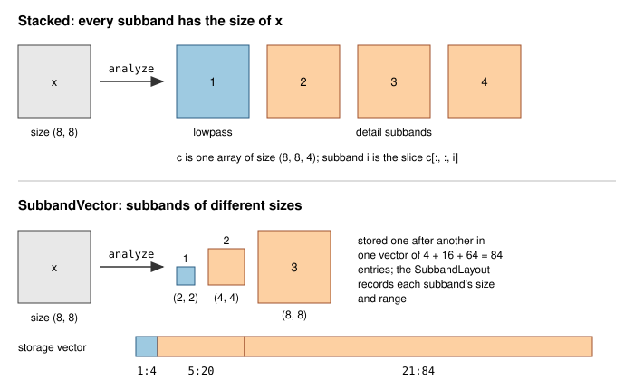

# Concepts

This page explains the objects of the MultiscaleTransformsBase interface and the
properties all implementations share. The functions themselves are documented
in the [API reference](@ref).

## Multiscale transforms

A multiscale transform maps an array `x` to *coefficients* grouped into
*subbands*. The *lowpass* subband holds the coarse content of `x`; each detail
subband holds the content of one scale and, for directional transforms such as
contourlets, surfacelets and shearlets, of one direction. *Analysis*
([`analyze`](@ref)) computes the coefficients; *synthesis*
([`synthesize`](@ref)) computes the data back from them.

## Transforms, workspaces and coefficients

The interface separates three kinds of object:

- The **transform** holds the parameters of the decomposition: the number of
  scales, the directions per scale, the filters. It holds nothing that depends
  on the data's size or element type, so one transform serves arrays of any
  size it accepts. Transforms are immutable values: two with equal parameters
  are `==` and have equal `hash`.
- The **workspace** holds what a transform computes in advance for one data
  size, element type and array type: filter responses, FFT plans, scratch
  buffers. Repeated calls with the same workspace skip that work. Because it
  holds scratch buffers, a workspace serves one call at a time. A transform
  that precomputes nothing still has a workspace, which records the transform,
  element type and size, so every transform accepts the same calls.
- The **coefficients** are an array, so that generic code, such as an iterative
  solver, can broadcast over them and apply `norm`, `dot` and the in-place
  `LinearAlgebra` updates without knowing the transform.

## How coefficients are stored

Subband 1 is always the lowpass; [`subband_layout`](@ref) describes the others
in order. Transforms store their subbands in one of two ways:

- **Stacked.** When every subband has the size of `x`, as in nonsubsampled and
  translation-invariant transforms, the coefficients are one array of size
  `(size(x)..., n)` and subband `i` is its slice `i` along the last axis.
- **[`SubbandVector`](@ref).** When subbands have different sizes, as in
  decimated transforms, they are stored one after another in a single vector.
  A [`SubbandLayout`](@ref) records each subband's size and range in that
  vector, and the size of the data. Arithmetic, broadcasting and the
  `LinearAlgebra` operations run on the storage vector as a whole, so they
  work on GPU arrays without indexing single elements.

In both cases [`subband`](@ref) returns a view of one subband with its own
shape, and writing to the view changes the coefficients.

## Synthesis, inverse and adjoint

`synthesize(t, analyze(t, x)) ≈ x` holds for every transform: synthesis
inverts analysis. Synthesis is also the adjoint of analysis only when the
transform is a *Parseval frame* (a tight frame with bound 1), that is, when
analysis preserves the norm: `norm(analyze(t, x)) ≈ norm(x)`. For other
transforms, the adjoint differs from `synthesize`. Each transform package
states which of its transforms are Parseval frames.

Redundant transforms have more coefficients than data: `length(c) / length(x)`
is the redundancy. Stacked transforms with `n` subbands have redundancy `n`.

## Complex data

The filters of the implementing packages are real. Complex data is transformed
as its real and imaginary parts, so every transform is real-linear:
`analyze(t, x + im * y) ≈ analyze(t, x) + im * analyze(t, y)` for real `x`
and `y`. The conformance tests in
[`MultiscaleTransformsBase.Testing`](@ref) check this for every
implementation.

## Threads

Results do not depend on the `threaded` keyword beyond rounding.
